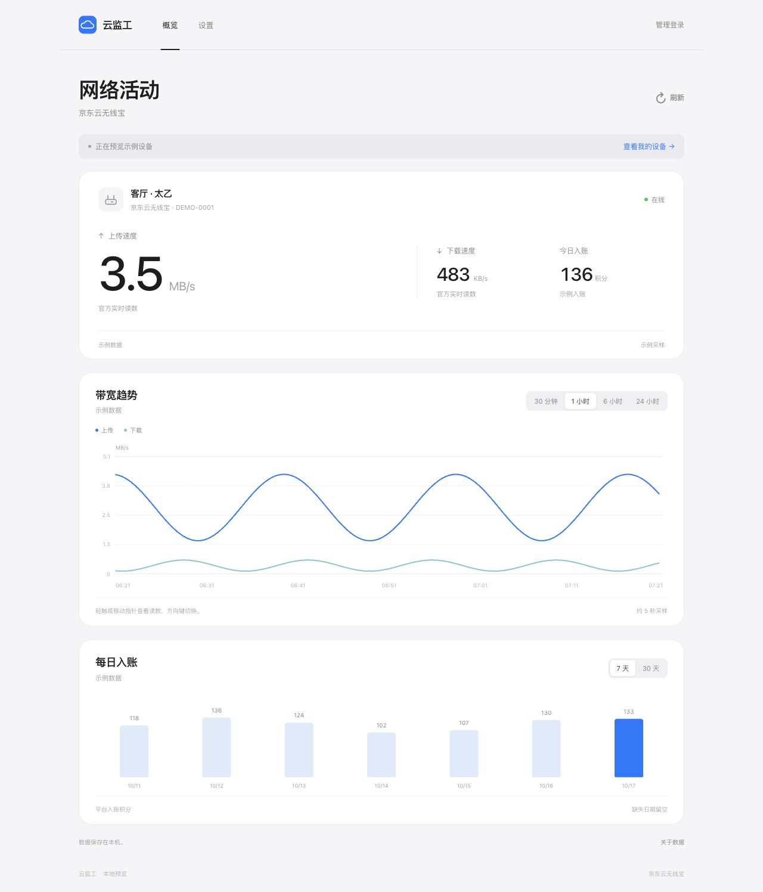

# 云监工 · Yunjian Monitor

自托管的京东云无线宝监控网页，查看设备上传／下载速度、在线状态和平台入账积分。

原生 HTML / CSS / JavaScript + Node.js 24 + SQLite，**无 npm 第三方运行依赖，无前端构建步骤**。支持电脑和手机，适合个人设备监控，也可作为同类工具的实现参考。



[查看手机演示截图](docs/images/mobile.png)。

> 本项目为独立实现，与京东官方、饭团云监工无隶属关系。使用已有 TGT / WSKEY 查询本人授权设备；不提供平台账号密码登录或未经核实的自动续期。历史接口可能变化，当前验证范围见[接口核查记录](docs/核查记录.md)。截图使用生成的演示数据。

## 功能

- 单设备首页突出上传速度；多设备时显示设备列表、筛选与账户选择。
- 直接读取平台设备状态，按已核对的客户端规则切换 KB/s、MB/s 等单位。
- 上下行默认约 5 秒采集，设备列表约 60 秒更新；按账户加锁，避免请求重叠。
- 30 分钟 / 1 小时曲线展示逐次采样，6 / 24 小时展示每分钟平均值与峰值；支持触摸、指针和方向键查看读数。
- 最近两小时保留逐次采样，分钟历史保留 7 天；中断处留空，不补造历史。
- 收益在北京时间 00:00–02:00 每 10 分钟、其他时段每小时确认，跨日立即重新查询。
- 7 / 30 天每日入账趋势，仅记录实际观测日期；每日记录保留 90 天。
- 多账户、凭据更新、重复接入识别、CSV 导出；删除账户会删除对应采样。
- AES-256-GCM 加密平台凭据，scrypt 保存管理密码散列；HttpOnly 会话、来源和 CSRF 校验、登录限速。
- 采集暂停或断连时旧读数变灰，明确显示上次采样时间。
- 每日在线备份、保留 7 份，检查数据库完整性和凭据能否解密；备份中移除网页会话。

## 快速开始

需要 **Node.js 24**。请从 [Node.js 官网](https://nodejs.org/) 安装并确认 `node --version` 为 24.x。

```sh
git clone https://github.com/sh0096/yunjian-monitor.git
cd yunjian-monitor
node scripts/init.mjs
npm start
```

初始化会交互式设置管理密码，并生成随机加密密钥到 `.env`；已有配置不会被覆盖。打开 **http://127.0.0.1:8787**，先查看演示界面。

要接入真实设备：

1. 在 `.env` 中设置 `ENABLE_JD_LEGACY=true`，重新启动本应用。
2. 登录网页，进入“设置 → 添加账户”。
3. 填写账户备注，以及从本人官方 App 请求中取得的 TGT / WSKEY 值；不要包含请求头名称。两类请求使用不同值时，可展开填写独立 WSKEY。
4. 服务端验证设备列表后才会保存加密凭据并开始采集。

账户备注不是京东登录名，无需填写手机号。TGT / WSKEY 等同登录凭据，请勿提交到 GitHub Issue、截图、URL 或公共日志中。

`.env.example` 只说明配置字段，不含可用密钥；实际配置应由初始化工具生成。

## 部署与使用说明

- [VPS 与 HTTPS 部署](docs/部署.md)：独立 systemd 服务、SSH 首次设置、已有反向代理及独立 8443 入口。
- [架构与网页 API](docs/架构与API.md)：采集、存储、接口边界及单位。
- [接口核查记录](docs/核查记录.md)：实际接口、证据来源、签名、大整数 ID、单位及兼容范围。
- [备份、恢复与升级](docs/恢复与升级.md)：密钥分开保存、在线备份与恢复步骤。
- [贡献说明](CONTRIBUTING.md)：本地检查和提交问题时的脱敏要求。

服务只监听本机回环地址。对外开放应配置 HTTPS 与正确的 `PUBLIC_ORIGIN`，不要直接开放开发服务端口。仓库中的域名均为示例；没有在线公共演示站点。

## 常用命令

```sh
npm test
npm run backup
node --env-file=.env scripts/reset-password.mjs
```

备份和密码重置要求已经初始化。密码重置为交互式输入，会清除所有旧网页会话。备份文件在数据目录的 `backups/` 下，解密密钥不包含在数据库副本中。

仓库附有 [GitHub Actions 配置示例](docs/examples/github-actions.yml)。需要自动检查时，将它复制到 `.github/workflows/test.yml` 并使用具备 workflow 权限的 GitHub 授权提交。测试使用生成的假凭据和替代请求，不访问真实平台账户。

## 数据口径与限制

- “今日入账”是平台接口的入账积分，不等同当天实时赚取的收益，不自动换算现金。
- 接口原始 `upload/download` 乘 1024 得到 bit/s；界面按 1024 进位显示字节速率。`8192 → 1 MB/s`，`8000 → 1000 KB/s`。内部历史字段 `uploadBps/downloadBps` 沿用早期命名，实际单位为 **bit/s**。
- 401 暂停直到更新凭据；403 标记拒绝访问并暂停 15 分钟；429 暂停 30 分钟；其他错误暂停 5 分钟。未知业务错误不会武断地当作登录态过期。
- 未发现可靠的官方 TGT 固定有效期或公开刷新协议，失效后需在官方 App 中取得新凭据。
- 已验证单一授权账户与设备，不能保证所有硬件、固件、账户或未来客户端均兼容。
- 数据库副本依赖原加密密钥。单机定时备份不能覆盖整台服务器丢失的风险；异地备份需单独配置。

## 参考来源与许可

本仓库代码独立实现，协议核查参考了 [myleo1/JDC-Monitor](https://github.com/myleo1/JDC-Monitor)、[aaaaawhf/jdc-monitor](https://github.com/aaaaawhf/jdc-monitor)、[aaaaawhf/jdc-monitor-api](https://github.com/aaaaawhf/jdc-monitor-api) 等公开资料，以及官方客户端的相关状态展示路径。对应提交、用途及许可核查见[接口核查记录](docs/核查记录.md)，不包含这些项目或客户端的源码、安装包。

本仓库原创代码采用 [MIT License](LICENSE)。第三方平台、商标及参考资料的权利归各自所有者。
